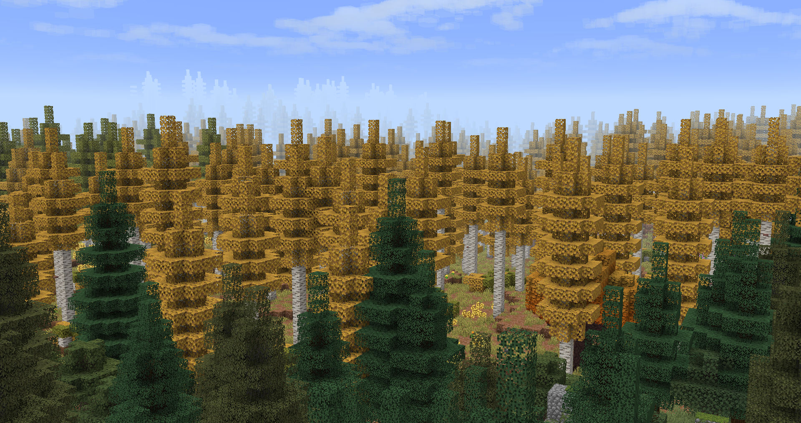

---
navigation:
  icon: ae2:controller
  title: The TechPack
  position: 1
---

### Early Access
* The project is currently in testing, so bugs are expected. If you find one, please report it through the Discord server.

## Welcome to TechPack!
Build your way through the development of technology, from simple machines to advanced systems capable of taking you beyond Earth. Along the way, explore the strange magic of this world and eventually reach other planets.

TechPack combines technology, magic, automation and exploration into one progression. Build your own infrastructure, automate what you can, discover new mechanics and work your way towards space travel and colonization.

## What to Expect
- **Guided, but not restrictive:** The progression is divided into chapters to give you an idea of what to work towards, without forcing you to follow a single path.   
- **Hand-made content:** Custom machines are designed with their own purpose, sounds, recipes, configurations and upgrades.
- **No unnecessary content:** Custom mechanics, assets and integrations are added because they have a purpose in the pack.
- **Quality focused effort:** many items and mechanics from other mods have been given new assets or recipes to align with the project's vision, while staying true to its underlying philosophy.
- **Easy access to information:** Even with more complex systems, you won't have to figure everything out on your own. ModdedPedia, EMI and custom tooltips are integrated to provide information when you need it
    
## Built for Performance and Exploration
TechPack is made to give you plenty of things to build, automate and explore without filling the pack with unnecessary content.

There's always something else to work towards, whether that's improving your factory, exploring the world or reaching the next planet.
